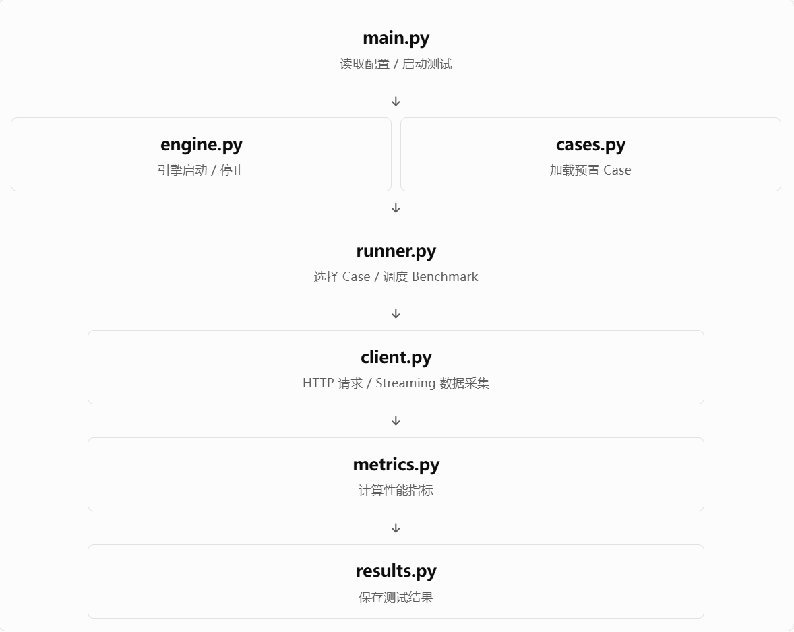

```
Evospeed_lite/
│
├── main.py                  # 程序入口
├── config.json              # 测试配置
├── pyproject.toml           # uv 项目依赖
├── uv.lock
│
├── benchmark/               # 性能测试核心模块
│   ├── __init__.py
│   ├── config.py            # 配置读取与校验
│   ├── engine.py            # 推理引擎生命周期管理
│   ├── cases.py             # Case 加载和管理
│   ├── client.py            # HTTP API 请求
│   ├── runner.py            # Benchmark 调度和执行
│   ├── metrics.py           # 性能指标计算
│   └── results.py           # 测试结果保存
│
├── cases/                   # 预置测试数据
│   ├── case_001.json
│   ├── case_002.json
│   └── case_003.json
│
├── scripts/                 # 推理引擎启动脚本
│   └── start_engine.sh
│
├── templates/               # 标准配置与样例备份
│   ├── config.sample.json
│   └── case.sample.json
│
├── results/                 # Benchmark 输出结果
│
└── tests/                   # 单元测试
    ├── test_engine.py
    ├── test_cases.py
    └── test_metrics.py
```


